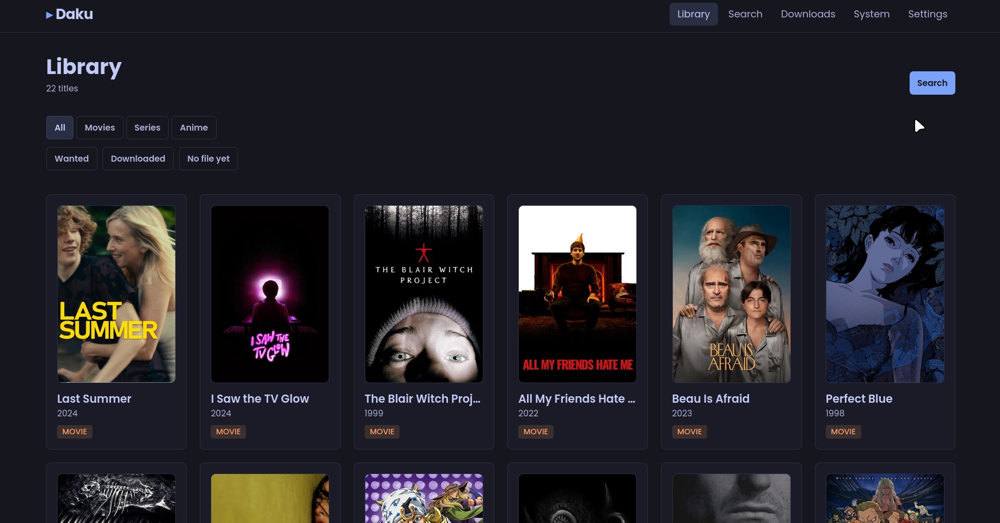
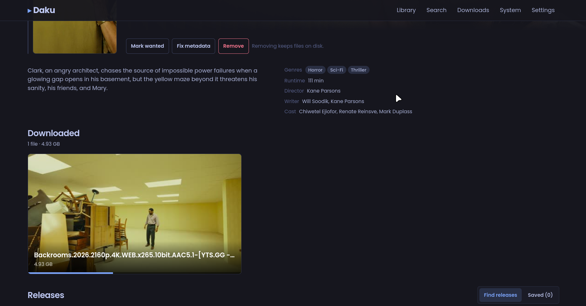

# Daku

**Alpha release — `0.1.0a1`.** A self-hosted, single-user, LAN-only media librarian for Linux.

Daku finds titles, saves releases, downloads them with qBittorrent or aria2c, and puts the
finished files one click away from your host player. It is driven from any browser on your
LAN and runs as a `systemd --user` service.

Daku does not decode or play video itself: on explicit request it launches the host's own
**mpv** with a library path it resolved. There is no in-app player, no transcoding and no
streaming while downloading.

> [!WARNING]
> Daku has **no authentication** and is meant for a trusted private network only. Never
> port-forward it or expose it to the internet.

---

## Screenshots

| Library | Title page |
|---|---|
|  |  |

---

## Features

### Library and metadata
- Search IMDb suggestions, with Cinemeta as a fallback, and add movies or TV series to a
  local SQLite library. Entries can exist with no download and no file.
- Anime metadata from AniList and Jikan, with AniBridge mappings for provider ids, episode
  ranges and split-cour seasons.
- Rich title pages: poster, banner, overview, genres, runtime, director/writer/cast, IMDb
  rating and optional Rotten Tomatoes / Metacritic ratings through an OMDb key.
- Manual metadata fixer for kind, identity, aliases and per-episode renumbering. Overrides
  are persisted separately so a metadata refresh cannot overwrite your decision.
- AniList identity validation: a manga id is rejected instead of silently saved, and a
  failed refresh can repair dead artwork.
- Wanted / downloaded / "no file yet" filters, watch-status labels and toasts.

### Release discovery
- **Torrentio** for movies and TV, with per-kind provider lists, quality filters, dedupe,
  sorting and a 200-row limit.
- **AnimeTosho**'s JSON feed for anime, merged with Torrentio. Anime is never searched on
  Torrentio-only sources unless you select them, and movies/TV never call AnimeTosho.
- Search every known title alias (English, romaji, native, AniBridge synonyms) in several
  notations, then match the episode from the parsed filename and the provider season —
  including split-cour offsets.
- Save releases independently of downloads. Saving a magnet never starts a download.
- Optional libtorrent metadata probe to list a torrent's files without downloading payload
  (requires the `probe` extra).
- Season packs are badged as packs. Downloading one lets you select the exact episode file,
  enforced through qBittorrent file priorities; batches are never silently attached to a
  single episode.

### Downloads
- **qBittorrent** (Web API v2) for torrents: add, pause/stop, resume/start, live progress,
  file selection, retry and removal. Supports qBittorrent 4.x, 5.0–5.1 and 5.2+.
- **aria2c** (JSON-RPC) for direct HTTP/DDL URLs.
- Live download progress over SSE, per-file progress and a downloaded-files view.
- Removing a queue entry keeps library files. Destructive "also delete the files" is
  refused when Daku cannot verify another copy exists.
- Availability is computed from files that actually exist: a deleted file stops being
  reported as available, and stale media rows can be cleaned up from the title page.

### Files and playback
- Downloaded-files carousel on the title page, a full files page with season tabs, and
  ffmpeg-generated thumbnails cached under `data_dir/thumbnails`.
- Launch a downloaded file in the host's **mpv** with one click. Only one child is tracked,
  and a user-started mpv is left alone.
- Playback progress is read from mpv's JSON IPC socket and shown as a seek bar on file cards.
  Progress is display-only: Daku never seeks or controls the player, and it survives a
  restart.

### Operations
- `daku doctor` probes every integration without serving the app (`--json`, `--strict`).
- SQLite in WAL mode with append-only migrations.
- Secrets live in a `0600` `secrets.json`; magnets, tokens and passwords are never logged.
- Responsive React UI suitable for phone, tablet and desktop.

## Not implemented yet (roadmap)

This is an alpha; some planned pieces are still missing:

- **Organiser (T-013):** finished downloads still live in `downloads_dir`. Daku does not yet
  hardlink/copy them into `movies_dir`, `tv_dir` or `anime_dir`, so those library folders are
  not populated by Daku yet.
- **Jellyfin (T-014):** no library scan or item lookup.
- **Telegram (T-015–T-017):** no bot, archive channel or file pull-back.
- **PWA install (T-018)** and the real installer/systemd setup (T-019).
- **Hardening (T-020)** and remaining watch-status / metadata-recovery tickets.
- A real installer, wider platform support (macOS/Windows) and multi-user auth are out of
  scope for v1.

The full ticket list and dependency graph live in [`plan.md`](plan.md) and
[`tickets/`](tickets/README.md).

---

## Requirements

| Component | Notes |
|---|---|
| Linux | systemd user services, XDG paths. v1 target. |
| Windows | Via **WSL2** (recommended). Native Windows is experimental; see [Windows](#windows). |
| Python 3.12 + [uv](https://docs.astral.sh/uv/) | Backend and CLI |
| Node 20+ + [pnpm](https://pnpm.io/) | Builds the web UI |
| qBittorrent (`qbittorrent-nox`) | Torrent engine; enable the Web UI |
| aria2c | Direct downloads (optional until you use them) |
| ffmpeg / ffprobe | Thumbnails and media inspection |
| mpv | Optional, for launching files on the host |
| libtorrent | Optional, `probe` extra for torrent file listing |

---

## Install on Linux

### 1. Install the runtime dependencies

```bash
# Debian/Ubuntu example — use your distro's packages
sudo apt install python3.12 qbittorrent-nox aria2 ffmpeg mpv
```

Install `uv`, `pnpm` and Node from their own installers if you do not already have them.

### 2. Clone and install the project

```bash
git clone <your-fork-url> daku
cd daku

uv sync                  # backend dependencies
# or, for torrent file listing (optional):
# uv sync --extra probe

pnpm -C web install
pnpm -C web build        # emits the SPA into src/daku/webdist/
```

### 3. Configure qBittorrent

Enable the Web UI on `127.0.0.1:8080` in qBittorrent's preferences, then put the username
and password in Daku's `secrets.json`.

### 4. Configure Daku

Daku reads configuration from, in order: environment variables (`DAKU_*`), then
`~/.config/daku/config.json`, then built-in defaults. Secrets are read from
`~/.config/daku/secrets.json` (created with `0600` on first run).

Minimal `~/.config/daku/config.json`:

```json
{
  "host": "0.0.0.0",
  "port": 8420,
  "downloads_dir": "~/Downloads/Daku",
  "movies_dir": "~/Media/Movies",
  "tv_dir": "~/Media/TV",
  "anime_dir": "~/Media/Anime",
  "qbt_url": "http://127.0.0.1:8080",
  "qbt_user": "admin",
  "aria2_rpc": "http://127.0.0.1:6800/jsonrpc",
  "mpv_enabled": true
}
```

`~/.config/daku/secrets.json`:

```json
{
  "qbt_pass": "your-qbittorrent-password",
  "aria2_secret": "",
  "omdb_api_key": ""
}
```

Environment overrides use the same field names uppercased with a `DAKU_` prefix, for
example `DAKU_PORT=8420`, `DAKU_DOWNLOADS_DIR=/srv/media/downloads`,
`DAKU_MPV_ENABLED=false`, `DAKU_QBT_PASS=...`.

### 5. Run it

```bash
uv run daku            # serve on http://0.0.0.0:8420
uv run daku doctor     # check every integration first
```

Open `http://<host-ip>:8420` from any device on the LAN.

### 6. Run it as a user service (optional, placeholder)

`packaging/daku.service` is a starting point. A real installer (T-019) is planned, so adjust
`ExecStart` to your checkout/virtualenv and add your display environment so mpv can open a
window when the service is started outside a graphical session:

```ini
Environment=DISPLAY=:0
# Environment=WAYLAND_DISPLAY=wayland-0
```

```bash
mkdir -p ~/.config/systemd/user
cp packaging/daku.service ~/.config/systemd/user/daku.service
systemctl --user daemon-reload
systemctl --user enable --now daku
systemctl --user status daku
journalctl --user -u daku -f
```

### 7. Verify

```bash
uv run daku doctor
```

The doctor reports each integration as `ok`, `warn`, `unavailable` or `disabled` without
starting a probe, launching mpv or downloading anything.

---

## Windows

Windows is **not a v1 target**. The supported way to run Daku on Windows is **WSL2**, which
gives you the same Linux environment the project is built and tested for. Native Windows
works for the core app, but some features are experimental — see the caveats below.

### Option A — WSL2 (recommended)

This runs Daku, qBittorrent and aria2 inside an Ubuntu environment while you use it from a
normal Windows browser.

1. Install WSL2 and Ubuntu from PowerShell (run as Administrator), then reboot:

   ```powershell
   wsl --install -d Ubuntu-24.04
   ```

2. Open the Ubuntu terminal and install the runtime dependencies:

   ```bash
   sudo apt update
   sudo apt install -y python3.12 python3.12-venv git aria2 ffmpeg mpv qbittorrent-nox
   curl -LsSf https://astral.sh/uv/install.sh | sh
   curl -fsSL https://deb.nodesource.com/setup_22.x | sudo -E bash -
   sudo apt install -y nodejs
   corepack enable pnpm
   ```

   Restart the shell so `uv` is on `PATH`.

3. Clone and build exactly as in the Linux instructions:

   ```bash
   git clone <your-fork-url> daku
   cd daku
   uv sync
   pnpm -C web install
   pnpm -C web build
   ```

4. Configure qBittorrent and Daku using the Linux paths from
   [step 4](#4-configure-daku). Files stay inside the WSL filesystem (for example
   `~/Downloads/Daku` and `~/Media`); avoid `/mnt/c/...` for the library because hardlinks
   and permissions do not behave the same across the Windows drive mount.

5. Run it:

   ```bash
   uv run daku doctor
   uv run daku
   ```

   Open `http://localhost:8420` in your Windows browser. WSL2 forwards `localhost`
   automatically.

6. **Optional: systemd as a user service.** Add this to `/etc/wsl.conf`:

   ```ini
   [boot]
   systemd=true
   ```

   Then run `wsl --shutdown` from PowerShell, reopen Ubuntu, and follow
   [step 6](#6-run-it-as-a-user-service-optional-placeholder). You may also need
   `sudo loginctl enable-linger "$USER"` so the user service starts without a login.

7. **Optional: access from other LAN devices.** `localhost` works on the Windows host, but
   other devices cannot reach the WSL2 VM directly. In an Administrator PowerShell:

   ```powershell
   $wsl = (wsl hostname -I).Trim().Split()[0]
   netsh interface portproxy add v4tov4 listenport=8420 listenaddress=0.0.0.0 `
     connectport=8420 connectaddress=$wsl
   New-NetFirewallRule -DisplayName "Daku" -Direction Inbound `
     -LocalPort 8420 -Protocol TCP -Action Allow
   ```

   The WSL2 IP changes when the VM restarts, so re-run the `portproxy` command if access
   stops working. Only do this on a trusted private network.

### Option B — native Windows (experimental)

Everything runs directly on Windows. The core app, library, release search, downloads and
thumbnails work, but this path has **no CI coverage** and is not a supported target yet.

1. Install the dependencies with `winget` (or the upstream installers):

   ```powershell
   winget install astral-sh.uv
   winget install OpenJS.NodeJS.LTS
   winget install pnpm.pnpm
   winget install qBittorrent.qBittorrent
   winget install aria2.aria2
   winget install Gyan.FFmpeg
   ```

   Install [mpv](https://mpv.io/installation/) separately and make sure `mpv.exe` is on
   `PATH` if you want to launch files.

2. Clone and build:

   ```powershell
   git clone <your-fork-url> daku
   cd daku
   uv sync
   pnpm -C web install
   pnpm -C web build
   ```

3. Enable the qBittorrent Web UI on `127.0.0.1:8080`, then create
   `%USERPROFILE%\.config\daku\config.json`:

   ```json
   {
     "host": "0.0.0.0",
     "port": 8420,
     "downloads_dir": "C:/Users/<you>/Downloads/Daku",
     "movies_dir": "C:/Users/<you>/Media/Movies",
     "tv_dir": "C:/Users/<you>/Media/TV",
     "anime_dir": "C:/Users/<you>/Media/Anime",
     "qbt_url": "http://127.0.0.1:8080",
     "qbt_user": "admin",
     "aria2_rpc": "http://127.0.0.1:6800/jsonrpc",
     "mpv_enabled": true
   }
   ```

   Put the qBittorrent password in `%USERPROFILE%\.config\daku\secrets.json`:

   ```json
   { "qbt_pass": "your-qbittorrent-password" }
   ```

   Daku's database, logs and thumbnails live under `%USERPROFILE%\.local\share\daku` by
   default. Set `DAKU_CONFIG_DIR` and `DAKU_DATA_DIR` if you want them elsewhere.

4. Run it from PowerShell:

   ```powershell
   uv run daku doctor
   uv run daku
   ```

   Open `http://localhost:8420`.

**Native Windows caveats**

- There is no systemd or Windows service installer. Keep a terminal open, or wrap
  `uv run daku` in Task Scheduler or NSSM yourself.
- The mpv seek bar needs a Unix-domain IPC socket, which is not available to Daku on native
  Windows. Launching mpv works; live/stored playback progress does not.
- Library paths are Linux-first. Hardlink mode is unverified on NTFS; use `"organize_mode":
  "copy"` when the organiser lands.
- Run `uv run daku doctor` and check the `mpv`, `ffmpeg` and `library` rows before trusting
  playback or thumbnails.

---

## Development

```bash
uv sync
uv run daku
uv run pytest -q
uv run ruff check . && uv run mypy src

pnpm -C web install
pnpm -C web dev        # Vite on :5173, proxies /api to :8420
pnpm -C web test
scripts/check.sh       # ruff + format + mypy + pytest
scripts/check.sh --web # same, plus web tests
```

`daku db init`, `daku db migrate` and `daku db dump` manage the SQLite database. Schema
changes are append-only migrations gated by `PRAGMA user_version`.

Architecture, integration contracts and coding rules are documented in
[`AGENTS.md`](AGENTS.md); the design rationale is in [`plan.md`](plan.md).

---

## Disclaimer

Daku indexes public metadata and hands magnets to a torrent client. It hosts no content.
Only download material you have the right to access.
